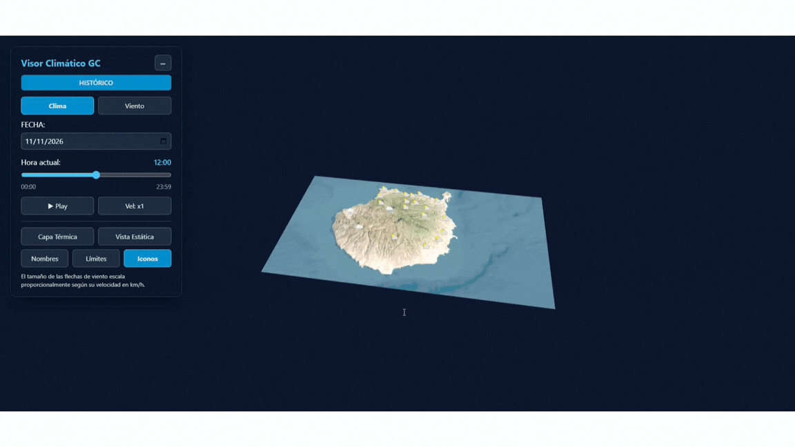

### UNIVERSIDAD DE LAS PALMAS DE GRAN CANARIA
**Grado en Ingeniería Informática — Asignatura: Informática Gráfica**  
*Curso Académico 2026/2027*

---

<h1 style="color: #38bdf8; font-size: 2.2rem; font-weight: bold; letter-spacing: 2px;">
  VISOR CLIMÁTICO 3D DE GRAN CANARIA
</h1>

<h3 style="color: #0284c7; font-size: 1.1rem; letter-spacing: 1px;">
  Desarrollado por: <a href="https://github.com/studies-ulpgc" style="color: #38bdf8; text-decoration: none; font-weight: bold;">Dácil Santana Ortega</a>
</h3>

---

## Índice de Contenidos

1. [Resumen del Proyecto](#1-resumen-del-proyecto)
2. [Demostración en Vídeo](#2-demostración-en-vídeo)
3. [Características Principales](#3-características-principales)
4. [Análisis Técnico y Arquitectura de Capas](#4-análisis-técnico-y-arquitectura-de-capas)
5. [Estructura del Código y Comparativa Académica](#5-estructura-del-código-y-comparativa-académica)
6. [Fuentes de Datos y Bibliografía](#6-fuentes-de-datos-y-bibliografía)

---

## 1. Resumen del Proyecto

Este proyecto consiste en un **visor gráfico interactivo en 3D** de la isla de Gran Canaria que integra información meteorológica en tiempo real e histórica. Está construido mediante **Three.js**, **Vite** y datos abiertos de **Open-Meteo**.

La aplicación ofrece dos modos de uso:
- **Modo Histórico (CSV):** Permite explorar mediante *timelapse* la evolución del clima a lo largo de los últimos 90 días con control horario desde [`climaData.csv`](./src/assets/data/climaData.csv).
- **Modo Tiempo Real (LIVE):** Obtiene los datos meteorológicos actuales directamente de las estaciones de los 21 municipios de la isla ([`municipios.js`](./src/municipios.js)).

---

## 2. Demostración en Vídeo

A continuación se presenta una vista previa de la aplicación:

**[Ver o descargar vídeo completo en MP4 (HD)](readme_media/demo/demo.mp4)**

---

## 3. Características Principales

| Funcionalidad | Descripción |
| :--- | :--- |
| **Terreno 3D Realista** | Deformación física de la superficie insular en [`main.js`](./src/main.js) basada en la lectura de relieve de un mapa de alturas ([`gc-heightmap.png`](./src/assets/relief/gc-heightmap.png)). |
| **Mapa Térmico Continuo** | Generación dinámica de capas de calor continuo en [`api.js`](./src/api.js) proyectadas sobre la isla según la temperatura municipal. |
| **Visualización del Viento** | Representación vectorial en 3D orientada según la dirección del viento y escalada según su velocidad. |
| **Perspectivas 3D y 2D** | Transición entre vista libre orbital en 3D (`OrbitControls`) y vista cenital plana 2D (`OrthographicCamera`). |
| **Etiquetado Inteligente** | Nombres de municipios con ocultación automática cuando quedan detrás de montañas. |
| **Controles Temporales** | Línea de tiempo interactiva con reproducción continua, selector de fecha y control de velocidad. |

---

## 4. Análisis Técnico y Arquitectura de Capas

---

### 4.1. Generación del Terreno 3D

Para lograr un relieve optimizado y preciso en [`main.js`](./src/main.js), se analiza la luminosidad de cada píxel de la imagen de elevación ([`gc-heightmap.png`](./src/assets/relief/gc-heightmap.png)) para elevar los vértices de la malla plana y recalcular sus normales de iluminación.

---

### 4.2. Capa Térmica Dinámica (Interpolación IDW)

En [`api.js`](./src/api.js), el gradiente de temperatura continuo se genera calculando la influencia de las temperaturas de los 21 municipios ([`municipios.js`](./src/municipios.js)) sobre la superficie insular:

1. Se aísla la superficie del terreno mediante una máscara sobre el mapa de elevación.
2. Se interpolan térmicamente los valores entre municipios en un canvas 2D secundario.
3. Se proyecta la textura resultante sobre el material del terreno ([`gc-texture.png`](./src/assets/relief/gc-texture.png)).

---

### 4.3. Capa Vectorial de Viento

Al activar la visualización de viento, se sustituyen los iconos estáticos ([`sun.png`](./src/assets/icons/sun.png), [`cloud.png`](./src/assets/icons/cloud.png), [`rain.png`](./src/assets/icons/rain.png), etc.) por vectores planos alineados sobre el terreno. Cada vector ajusta su rotación al ángulo del viento y su escala a la velocidad en km/h.

---

### 4.4. Oclusión de Nombres y Proyección Geoespacial

- **Proyección:** La lógica geoespacial en [`api.js`](./src/api.js) y [`geoutils.js`](./src/geoutils.js) traduce coordenadas de latitud y longitud a posiciones dentro del espacio 3D.
- **Oclusión:** En cada fotograma se traza la línea de visión entre la cámara y cada etiqueta HTML (`CSS2DRenderer`). Si el relieve del terreno interseca esa línea, la etiqueta se oculta automáticamente para evitar superposiciones no deseadas.

---

## 5. Estructura del Código y Comparativa Académica

### 5.1. Organización de Archivos

<pre><b>IG_S8-9/</b>
├── <a href="./readme_media/">readme_media/</a>                    # Recursos multimedia de la documentación
│   ├── <a href="./readme_media/assets/">assets/</a>                      # Logotipo institucional
│   └── <a href="./readme_media/demo/">demo/</a>                        # Previsualizaciones (<a href="./readme_media/demo/demo.mp4">demo.mp4</a> y <a href="./readme_media/demo/demo.gif">demo.gif</a>)
├── <a href="./src/">src/</a>                             # Código fuente de la aplicación
│   ├── <a href="./src/assets/">assets/</a>
│   │   ├── <a href="./src/assets/data/">data/</a>
│   │   │   ├── <a href="./src/assets/data/climaData.csv">climaData.csv</a>        # Registro histórico de los últimos 90 días
│   │   │   └── <a href="./src/assets/data/generarCSV.js">generarCSV.js</a>        # Script para descargar datos históricos de Open-Meteo
│   │   ├── <a href="./src/assets/icons/">icons/</a>
│   │   │   ├── <a href="./src/assets/icons/cloud.png">cloud.png</a>            # Icono de estado nublado
│   │   │   ├── <a href="./src/assets/icons/cloud_thunder.png">cloud_thunder.png</a>    # Icono de tormenta eléctrica
│   │   │   ├── <a href="./src/assets/icons/partly_cloudy.png">partly_cloudy.png</a>    # Icono de parcialmente nublado
│   │   │   ├── <a href="./src/assets/icons/rain.png">rain.png</a>             # Icono de lluvia
│   │   │   └── <a href="./src/assets/icons/sun.png">sun.png</a>              # Icono de cielo despejado
│   │   └── <a href="./src/assets/relief/">relief/</a>
│   │       ├── <a href="./src/assets/relief/gc-heightmap-inverted.png">gc-heightmap-inverted.png</a> # Mapa de alturas invertido
│   │       ├── <a href="./src/assets/relief/gc-heightmap.png">gc-heightmap.png</a>     # Mapa de elevación del terreno
│   │       ├── <a href="./src/assets/relief/gc-texture.png">gc-texture.png</a>       # Textura satelital de Gran Canaria
│   │       └── <a href="./src/assets/relief/lines.png">lines.png</a>            # Máscara de límites municipales
│   ├── <a href="./src/api.js">api.js</a>                       # Lógica de datos, mapa térmico y proyección
│   ├── <a href="./src/geoutils.js">geoutils.js</a>                  # Utilidades de conversión y cálculo geoespacial
│   ├── <a href="./src/index.html">index.html</a>                   # Estructura del documento e interfaz
│   ├── <a href="./src/main.js">main.js</a>                      # Escena de Three.js, controles y bucle de render
│   ├── <a href="./src/municipios.js">municipios.js</a>                # Coordenadas de los 21 municipios de Gran Canaria
│   └── <a href="./src/style.css">style.css</a>                    # Estilos visuales de la interfaz de usuario
├── <a href="./package.json">package.json</a>                     # Configuración del proyecto y dependencias
└── <a href="./README.md">README.md</a>                        # Documentación principal
</pre>

---

### 5.2. Scripts de Clase y Entornos CodeSandbox

Correspondencia técnica entre los ejemplos de clase ([`otsedom`](https://github.com/otsedom)) y su implementación en el proyecto:

- **Entorno CodeSandbox del Proyecto:** [Probar Proyecto en Sandbox](https://codesandbox.io/p/sandbox/elegant-black-762ynk?file=%2Fsrc%2Fapi.js)
- **CodeSandbox Semana 8 (Terrenos y Mapas):** [ig-s8-49qnzw](https://codesandbox.io/p/sandbox/ig-s8-49qnzw)

| Script de Referencia | Concepto Evaluado | Aplicación en este Proyecto |
| :--- | :--- | :--- |
| **[`script_21_terreno.js`](https://codesandbox.io/p/sandbox/ig-s8-49qnzw)** | Uso de mapa de desplazamiento y modificación de geometría plana. | Elevación por vértices desde lectura de mapa de alturas ([`gc-heightmap.png`](./src/assets/relief/gc-heightmap.png)) en [`main.js`](./src/main.js). |
| **[`script_24_mapasitycleta.js`](https://codesandbox.io/p/sandbox/ig-s8-49qnzw)** | Mapeo de coordenadas $(\text{Lat}, \text{Lon})$ a coordenadas 3D. | Proyección geoespacial completa de municipios ([`municipios.js`](./src/municipios.js)) en [`api.js`](./src/api.js) y [`geoutils.js`](./src/geoutils.js). |
| **[`script_25_mapasitycletav2.js`](https://codesandbox.io/p/sandbox/ig-s8-49qnzw)** | Lectura de archivos CSV y animación temporal dinámica. | Procesamiento de [`climaData.csv`](./src/assets/data/climaData.csv) y simulación temporal interactiva. |
| **[`script_26_mapaosm.js`](https://codesandbox.io/p/sandbox/ig-s8-49qnzw)** | Integración de datos de contornos y límites geográficos. | Superposición de la capa de divisiones municipales ([`lines.png`](./src/assets/relief/lines.png)). |

## 6. Fuentes de Datos y Bibliografía

1. **API Open-Meteo:** [https://open-meteo.com/](https://open-meteo.com/) — Servicio de datos meteorológicos históricos y en tiempo real.
2. **ArcGIS World Imagery Wayback:** [https://livingatlas.arcgis.com/wayback/](https://livingatlas.arcgis.com/wayback/) — Fuente de las imágenes satelitales para la textura del terreno ([`gc-texture.png`](./src/assets/relief/gc-texture.png)).
3. **Tangram Heightmapper:** [https://tangrams.github.io/heightmapper/](https://tangrams.github.io/heightmapper/) — Generación del mapa de elevación de Gran Canaria ([`gc-heightmap.png`](./src/assets/relief/gc-heightmap.png)).
4. **Documentación Oficial de Three.js:** [https://threejs.org/docs/](https://threejs.org/docs/)
5. **Repositorio de la asignatura (otsedom):** [https://github.com/otsedom](https://github.com/otsedom)

---

### 6.1. Declaración de Asistencia con Herramientas de Inteligencia Artificial

Durante el desarrollo del proyecto se empleó **Google Gemini** como herramienta de apoyo técnico, planificación y documentación:

- **Recomendación de API y estructura de datos:** Selección de la API abierta de [Open-Meteo](https://open-meteo.com/) frente a alternativas con clave de pago, y comprensión de sus parámetros horarios (`hourly`) y códigos meteorológicos WMO.
- **Cálculos geoespaciales y calibración de malla:** Apoyo en las fórmulas de proyección de coordenadas $(\text{Lat}, \text{Lon})$ al plano 3D, interpolación térmica inversa a la distancia (IDW) y ajuste de coordenadas UV para alinear el mapa de alturas con la textura satelital.
- **Depuración y resolución de errores:** Revisión de fallos de sincronización en la carga asíncrona de texturas, filtrado de valores nulos en el histórico CSV y oclusión de etiquetas HTML mediante trazado de rayos.
- **Planificación y documentación:** Organización modular del código (`main.js`, `api.js`, `geoutils.js`), distribución de tareas por hitos y estructuración técnica del presente documento `README.md`.

**Ejemplo de conversación de soporte técnico:**
- [Consulta sobre alineación de relieve](https://gemini.google.com/app/144c63cd03b894ed)

---

### 6.2. Autora y Colaboradores

| Desarrolladora | Rol | Perfil |
| :--- | :--- | :---: |
| **Dácil Santana Ortega** | Autora Principal y Programación |  |

---

*Proyecto desarrollado para la asignatura de **Informática Gráfica** — Grado en Ingeniería Informática (ULPGC).*  
*Bajo licencia [Creative Commons Reconocimiento - No Comercial 4.0 Internacional (CC BY-NC 4.0)](https://creativecommons.org/licenses/by-nc/4.0/deed.es).*

